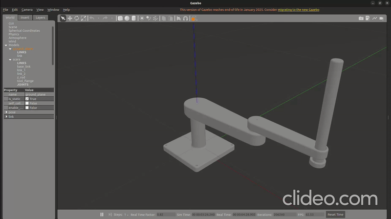
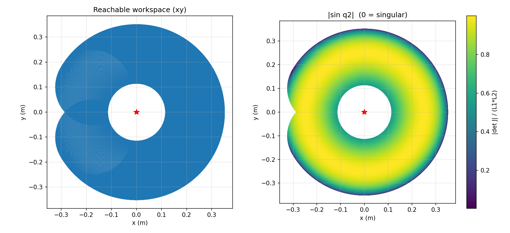
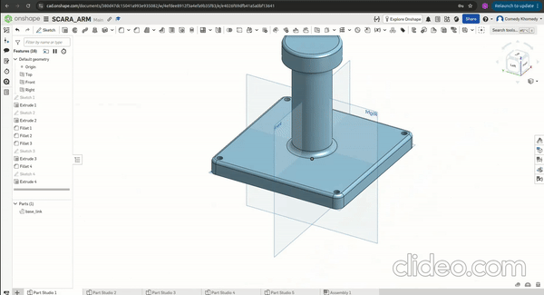
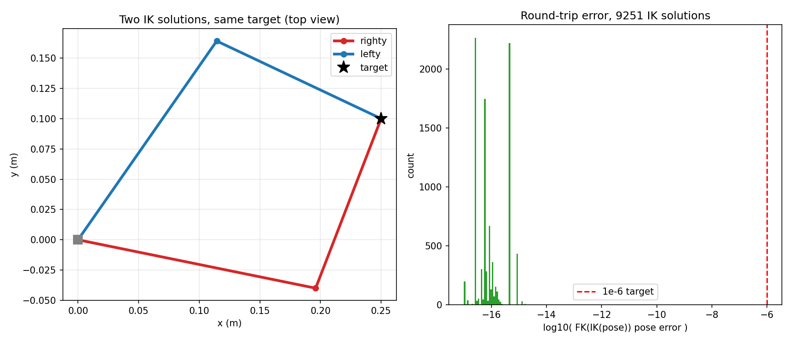
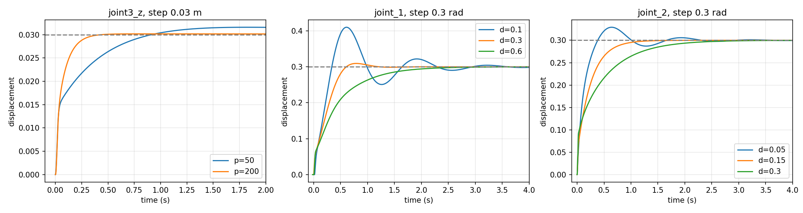
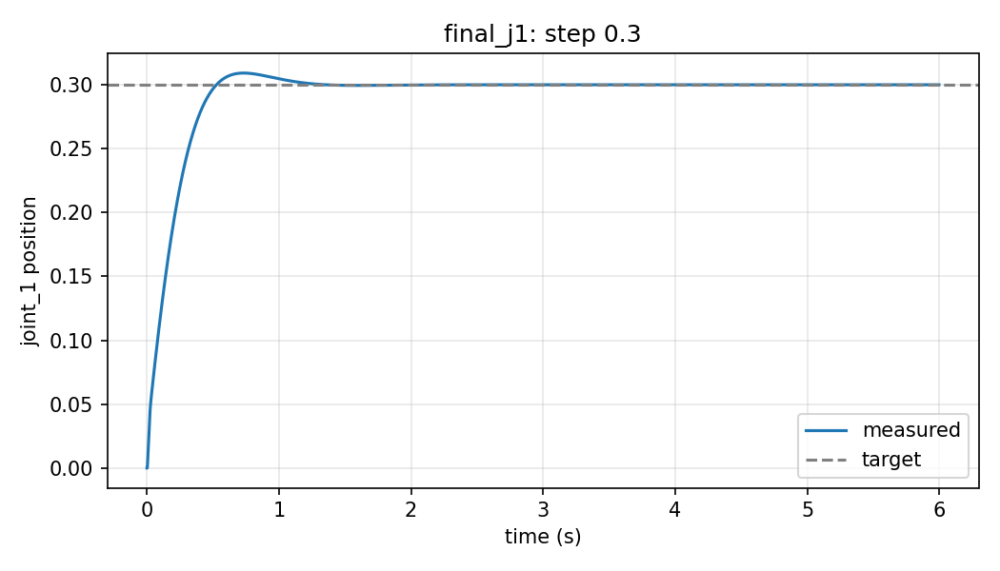

# 4-DOF SCARA Arm (RRPR): CAD → Kinematics → ROS 2 Simulation → Controller Tuning



A 4-DOF SCARA manipulator designed in Onshape and taken through a complete
simulation pipeline: URDF export, analytic kinematics, Gazebo + `ros2_control`,
and step-response PID tuning. Every claim below is backed by a reproducible
script in this repository. Simulation only; no hardware was built.

**Stack:** Onshape · ROS 2 Humble · Gazebo Classic 11 · `ros2_control` · Python (NumPy, Matplotlib)

## Highlights
- **Analytic FK/IK/Jacobian** validated against the URDF transform tree (`tf2_echo`).
- **IK round trip on 10,000 random poses:** max joint error 3.5e-12.
- **Closed-loop check in Gazebo:** IK → joint trajectory controller → TF.
  Over 6 IK solutions, worst position error 0.10 mm, worst yaw error 1.1e-5 rad.
- **PID tuning with measured step responses** (rise time, overshoot, settling time).
  Example: joint_1 overshoot 36.7% → 3.1%, settling 2.77 s → 0.94 s.



## Design specification
| Parameter       | Value                                    |
| --------------- | ---------------------------------------- |
| L1 / L2         | 200 mm / 150 mm                          |
| Reach (annulus) | 115.5 – 350 mm                           |
| Joint limits    | J1 ±150°, J2 ±145°, J4 ±180°             |
| Z stroke        | 100 mm                                   |
| Payload         | 500 g (design target, not yet simulated) |



## Results

### Kinematics ([docs/kinematics.md](docs/kinematics.md))
| Test                                                | Result                  |
| --------------------------------------------------- | ----------------------- |
| IK round trip, 10,000 poses                         | max joint error 3.5e-12 |
| FK(IK(pose)) vs pose, 9,251 solutions               | max pose error 1.8e-15  |
| Analytic vs finite-difference Jacobian, 5,000 poses | max diff 3.6e-10        |
| det J vs L1·L2·\|sin q2\|                           | max diff 2.4e-17        |

The arm is singular at q2 = 0 (fully stretched). The folded configuration lies
outside the joint limit, so the inner workspace boundary is a reach limit.



### Controller tuning ([docs/tuning.md](docs/tuning.md))
| Joint    | P    | I    | D      | Rise (s) | Overshoot (%) | Settling (s) |
| -------- | ---- | ---- | ------ | -------- | ------------- | ------------ |
| joint_1  | 1.0  | 0    | 0.3    | 0.356    | 3.1           | 0.939        |
| joint_2  | 0.5  | 0    | 0.15   | 0.542    | 0.0           | 0.922        |
| joint3_z | 200  | 20   | 20     | 0.163    | 0.6           | 0.302        |
| joint4   | 0.01 | 0    | 0.0005 | 0.106    | 0.0           | 0.192        |

Results were reproduced after a clean restart from `controllers.yaml`.
Changing only the P gain of `joint3_z` (200 → 50) changed settling from 0.30 s
to 4.32 s, which indicates the effort commands are acted on by the physics engine.





## Repository layout
```
scara_description/   ROS 2 package: URDF, meshes, controllers.yaml, launch files
kinematics/          FK, IK, Jacobian, workspace plots, simulation check
tuning/              step-response test, plotting, raw CSV results
docs/                kinematics.md, simulation.md, tuning.md, figures
media/               renders, sketches, demo GIF
```

## Quick start
```bash
# Kinematics only (no ROS needed)
pip install -r requirements.txt
cd kinematics && python3 scara_ik.py && python3 scara_jac.py

# Simulation (Ubuntu 22.04, ROS 2 Humble, Gazebo Classic)
colcon build --packages-select scara_description
source install/setup.bash
ros2 launch scara_description gazebo.launch.py
# in a second terminal
cd kinematics && python3 scara_sim_check.py
```
If the Gazebo window freezes on Wayland, the launch file already sets `QT_QPA_PLATFORM=xcb`.

## Limitations
- Tuning is a manual search over 2–3 gain values per joint, one parameter at a time.
  The chosen values are the best of those tested, not a proven optimum.
- One step size per joint, no payload, simulation only.
- Each step response shows a short fast rise followed by a slower approach; the cause was not investigated.
- IK does not check self-collision.
- Gazebo Classic is end-of-life; it was chosen for `gazebo_ros2_control` compatibility with Humble.

## Future work
Payload tests at the 500 g design target, Cartesian trajectory tracking,
MoveIt 2 integration (custom IK plugin), and comparison with learned controllers.

## Author
Moynul Rifat · [Portfolio](https://e-moynul.github.io) · MIT License
