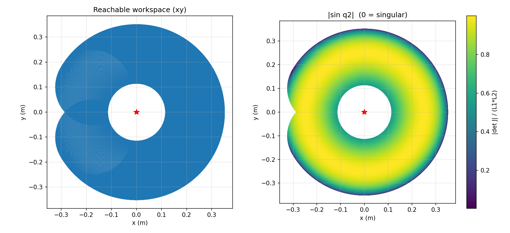
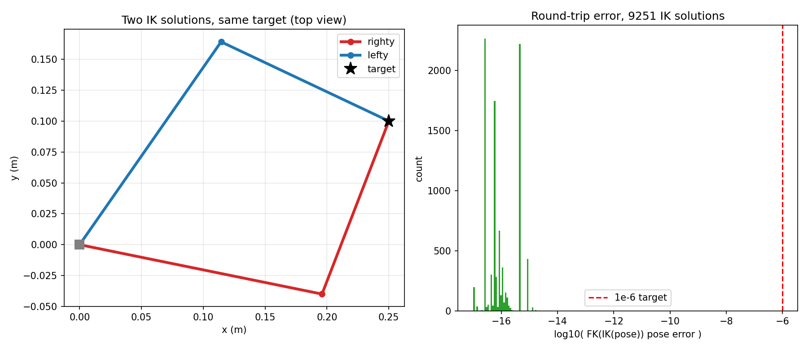

# 4-DOF SCARA (RRPR): Kinematics

All quantities are in SI units (m, rad). Joint values `q = (q1, q2, q3, q4)` follow the
URDF convention (`scara.urdf`). Tool pose is the `tool_flange` frame expressed in `base_link`.

## 1. Model parameters (read from the URDF)

| Parameter                    | Value                                      |
| ---------------------------- | ------------------------------------------ |
| Joint 1 height above base    | 0.170 m (0.135 + 0.035)                    |
| L1 / L2                      | 0.200 m / 0.150 m                          |
| Rod frame below link 2       | 0.012 m                                    |
| Flange frame below rod frame | 0.015 m                                    |
| Joint limits                 | q1 ±150°, q2 ±145°, q3 0–0.100 m, q4 ±180° |
| Tool pose at q = 0           | (0.350, 0, 0.143) m, yaw 0                 |

## 2. Joint conventions (verified against URDF/TF)

Joints 1 and 2 have their axes pointing down in the URDF, so a positive value rotates
clockwise seen from above; joint 4 points up; joint 3 moves the rod down for positive values.

    theta1 = -q1,   theta2 = -q2,   theta4 = -q4,   d3 = q3

## 3. DH table (standard convention)

| i    | theta | d          | a     | alpha |
| ---- | ----- | ---------- | ----- | ----- |
| 1    | -q1   | 0.170      | 0.200 | 0     |
| 2    | -q2   | 0          | 0.150 | pi    |
| 3    | 0     | q3 + 0.012 | 0     | 0     |
| 4    | -q4   | 0.015      | 0     | 0     |

`alpha2 = pi` makes the z-axes of frames 2-4 point down, so positive `q3` moves the tool down.

## 4. Forward kinematics

    x   = L1 cos(theta1) + L2 cos(theta1 + theta2)
    y   = L1 sin(theta1) + L2 sin(theta1 + theta2)
    z   = 0.143 - q3
    yaw = q4 - q1 - q2

Implementation: `kinematics/scara_kin.py` (matrix product of the four DH transforms).

## 5. Inverse kinematics

    c2     = (x^2 + y^2 - L1^2 - L2^2) / (2 L1 L2)        (out of reach if |c2| > 1)
    theta2 = +/- arccos(c2)
    theta1 = atan2(y, x) - atan2(L2 sin(theta2), L1 + L2 cos(theta2))
    q1 = -theta1,  q2 = -theta2,  q3 = 0.143 - z,  q4 = yaw + q1 + q2

Two configurations exist: `righty` (theta2 > 0, i.e. q2 < 0) and `lefty` (theta2 < 0).
Solutions outside the joint limits are discarded. Implementation: `kinematics/scara_ik.py`.

## 6. Jacobian and singularities

Rows (x, y, z, yaw), columns (q1, q2, q3, q4), with s1 = sin(theta1), s12 = sin(theta1 + theta2):

    J = [[ L1 s1 + L2 s12,      L2 s12,      0, 0],
         [-L1 c1 - L2 c12,     -L2 c12,      0, 0],
         [ 0,                    0,         -1, 0],
         [-1,                   -1,          0, 1]]
    
    |det J| = L1 L2 |sin q2|

The arm is singular at q2 = 0 (fully stretched, outer workspace boundary). The folded singularity
(q2 = 180 deg) lies outside the +/-145 deg limit, so the inner boundary is a reach limit, not a singularity.
Implementation: `kinematics/scara_jac.py`.

## 7. Validation

| Test                                                         | Result                                             |
| ------------------------------------------------------------ | -------------------------------------------------- |
| FK vs URDF TF (`tf2_echo`), 5 configurations (each joint moved separately) | match at the printed precision (1e-3 m / 1e-3 rad) |
| IK round trip, 10,000 random poses inside the limits         | all recovered, max joint error 3.5e-12             |
| FK(IK(pose)) vs pose, 9,251 IK solutions                     | max pose error 1.8e-15                             |
| Analytic vs finite-difference Jacobian, 5,000 poses          | max difference 3.6e-10                             |
| det J vs L1 L2 abs(sin q2), 5,000 poses                      | max difference 2.4e-17                             |

## 8. Workspace

Reach annulus: r_min = 115.5 mm, r_max = 350.0 mm. The +/-150 deg limit on joint 1 removes the
region directly behind the base.

## 9. Reproduce

    cd kinematics
    python3 scara_kin.py        # FK vs URDF values
    python3 scara_ik.py         # IK round-trip test
    python3 scara_jac.py        # Jacobian checks
    python3 plot_workspace.py   # workspace + singularity figure
    python3 plot_configs.py     # lefty/righty + error histogram
