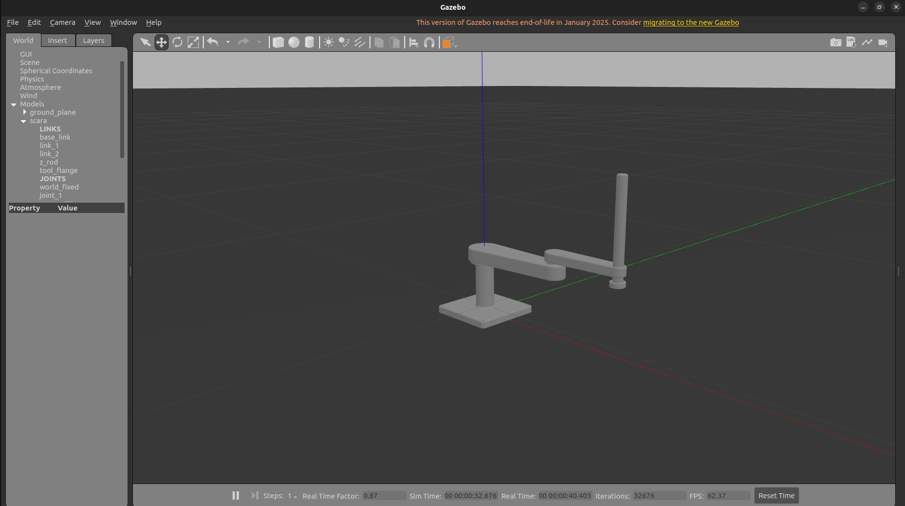

# Gazebo Simulation and ros2_control

This document covers Module 3: packaging the URDF, simulating the arm in Gazebo Classic, and
controlling it through `ros2_control`. All joint values use the URDF convention from
[kinematics.md](kinematics.md) (SI units).

## 1. Setup

| Item | Value |
|---|---|
| ROS 2 | Humble |
| Simulator | Gazebo Classic 11.10.2 (`gazebo_ros`, `gazebo_ros2_control` 0.4.10) |
| Package | `scara_description` (URDF, meshes, config, launch) |
| Controllers | `joint_state_broadcaster`, `joint_trajectory_controller` |
| Control interface | effort command, position and velocity state |
| Controller update rate | 1000 Hz |

Gazebo Classic reached end of life in January 2025. It is used here because it was already
installed and runs on the target laptop (Intel UHD graphics); the `ros2_control` configuration is
largely portable to the newer Gazebo.

## 2. Package structure

    scara_description/
      urdf/scara.urdf          URDF exported from Onshape, plus world link and ros2_control tags
      meshes/*.stl             visual and collision meshes (about 73k triangles in total)
      config/controllers.yaml  controller manager and PID gains
      launch/gazebo.launch.py  Gazebo, robot_state_publisher, spawn, controller spawners
      launch/spawn_only.launch.py  spawn only (used while debugging)

Mesh paths use `package://scara_description/meshes/...`. Gazebo Classic rewrites these to
`model://`, so the launch file appends the package's install directory to `GAZEBO_MODEL_PATH`.

## 3. Physical parameters (from the URDF)

| Link | Mass (kg) |
|---|---|
| base_link | 1.405 |
| link_1 | 0.204 |
| link_2 | 0.0893 |
| z_rod | 0.171 |
| tool_flange | 0.0144 |

Masses and inertias come from the Onshape export (material: Aluminum 6061) and were checked for
plausibility only, not recomputed independently. Gravity load on the z axis is about
(0.171 + 0.0144) kg x 9.81 m/s^2 = 1.8 N, below the 10 N effort limit.

## 4. Control configuration

Joint trajectory controller, effort command interface, PID gains per joint
(`config/controllers.yaml`):

| Joint | P | I | D | I clamp |
|---|---|---|---|---|
| joint_1 | 1.0 | 0 | 0.1 | 0 |
| joint_2 | 0.5 | 0 | 0.05 | 0 |
| joint3_z | 200 | 20 | 20 | 5 |
| joint4 | 0.01 | 0 | 0.0005 | 0 |

These are initial values chosen from the link inertias. They are not tuned (see Limitations).
The z joint has an integral term so the rod does not sag under gravity with a proportional
term alone.

## 5. Results

**Controller state.** Both controllers load and become active; `/joint_states` is published.

**Holding a setpoint.** Commanded to (0.5, -0.5, 0.05, 0.3):

| Time | joint_1 | joint_2 | joint3_z | joint4 |
|---|---|---|---|---|
| Shortly after the move | 0.500003 | -0.499994 | 0.050000 | 0.300000 |
| About 76 s of simulation time later | 0.500003 | -0.499994 | 0.049999990 | 0.299999994 |

Joint velocities stayed below 1e-4 in both samples, so the arm is stationary and the rod does
not drift towards the 0.1 m limit. Without a controller the rod falls to the 0.1 m limit.

**Kinematics versus simulation.** `kinematics/scara_sim_check.py` solves IK for target poses
(both configurations), sends the joint values to the controller, waits until the flange stops
moving, then compares the measured `base_link -> tool_flange` transform (from `tf`) with the
FK prediction.

| Target (x, y, z, yaw) | Config | Position error (mm) | Yaw error (rad) |
|---|---|---|---|
| (0.25, 0.10, 0.10, 0.3) | righty | 0.0012 | 7.5e-06 |
| (0.25, 0.10, 0.10, 0.3) | lefty | 0.0022 | 7.3e-06 |
| (0.30, -0.12, 0.05, -1.0) | righty | 0.0515 | 2.2e-04 |
| (0.30, -0.12, 0.05, -1.0) | lefty | 0.0033 | 1.1e-05 |
| (0.15, -0.05, 0.08, 0.0) | righty | 0.0020 | 9.4e-06 |
| (0.15, -0.05, 0.08, 0.0) | lefty | 0.0018 | 1.0e-05 |

Worst position error 0.0515 mm, worst yaw error 2.2e-4 rad. A fourth target
(0.2, 0.2, 0.02, 2.0) has no IK solution because z = 0.02 m requires q3 = 0.123 m, beyond the
0.1 m stroke; the valid z range is 0.043 to 0.143 m.

## 6. Limitations

- The PID gains are untuned starting values. Step-response analysis and tuning are the next
  module.
- That the effort commands act through the physics engine (rather than setting joint positions
  directly) is supported by the observed gravity sag recovering slowly under the integral term,
  but it has not been proven independently. Step responses under different gains will test it.
- The settling check in `scara_sim_check.py` stops waiting when the flange moves less than
  0.01 mm per second, so the largest error (0.05 mm) may partly come from measuring slightly
  early.
- Only four target poses (six configurations) were tested. The IK does not check
  self-collision.
- Gazebo's GUI was not tested with LIBGL_ALWAYS_SOFTWARE removed on Wayland beyond the fix below.

## 7. Reproduce

    cd ~/scara_robot
    source /opt/ros/humble/setup.bash
    colcon build --packages-select scara_description
    source install/setup.bash
    ros2 launch scara_description gazebo.launch.py

In a second terminal (with the same two `source` lines):

    ros2 control list_controllers
    python3 kinematics/scara_sim_check.py

## 8. Troubleshooting notes

- **Black screen or freeze in the Gazebo GUI (Ubuntu on Wayland).** The launch file sets
  `QT_QPA_PLATFORM=xcb`, which fixed it on the test machine. Make sure `LIBGL_ALWAYS_SOFTWARE`
  is not set in the shell.
- **Robot spawns but meshes fail to load (`Failed to find mesh file [model://...]`).** Gazebo
  Classic cannot resolve `model://scara_description`. The launch file extends
  `GAZEBO_MODEL_PATH` for this reason.
- **`Couldn't parse parameter override rule` from gazebo_ros2_control.** The URDF is passed as a
  ROS parameter and is parsed as YAML, so text such as `Onshape document_id: ...` in XML comments
  breaks it. The launch file strips XML comments from the URDF it sends to Gazebo.